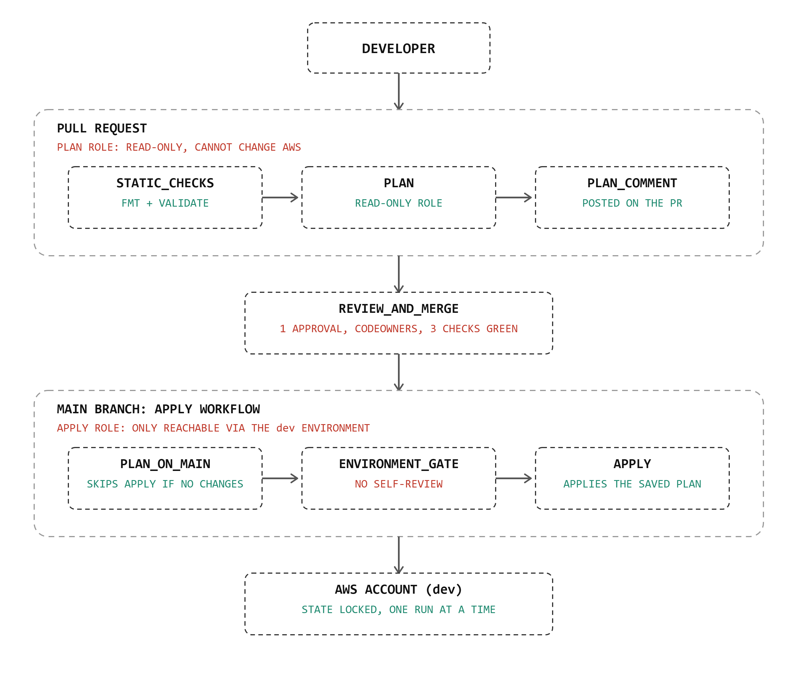

# cob-data-platform

Data Engineering's data lake on AWS, built entirely from
[COB](https://github.com/Eyitoyosi/cob) modules and delivered through an
automated, reviewed Terraform pipeline. Nothing reaches AWS except through
a pull request, a review, and an approved deployment.



## What this is

- A `dev` data lake: a raw zone and a curated zone (S3), a Glue Data
  Catalog with a crawler, and an Athena workgroup for SQL over the data.
- Built from COB modules pinned to a release tag (`storage-s3` and
  `data-platform`, currently `v0.1.3`). No COB module is copied or
  recreated in this repository.
- Delivered by GitHub Actions: pull requests are checked and planned,
  merges are planned again, and a reviewer approves each deployment.

## Data lake resources (dev)

| Resource | Name | Source |
|---|---|---|
| Raw zone bucket | `cob-dev-beejan-lake-raw` | COB `storage-s3` |
| Curated zone bucket | `cob-dev-beejan-lake-curated` | COB `storage-s3` |
| Glue database | `cob_dev_beejan_lake` | COB `data-platform` |
| Glue crawler | `cob-dev-beejan-lake-crawler` | COB `data-platform` |
| Athena workgroup | `cob-dev-beejan-lake` | COB `data-platform` |
| Query results bucket | `cob-dev-beejan-lake-athena-results` | COB `data-platform` (via `storage-s3`) |
| Sample dataset | `orders/orders.csv` in the raw bucket | This repo (application-specific) |

Try it (Athena console, workgroup `cob-dev-beejan-lake`, database
`cob_dev_beejan_lake`):

```sql
SELECT product, SUM(quantity) AS units_sold,
       ROUND(SUM(quantity * unit_price), 2) AS revenue
FROM orders GROUP BY product ORDER BY revenue DESC;
```

## Repository structure

```
cob-data-platform/
├── .github/
│   ├── CODEOWNERS                  # who must review which paths
│   ├── pull_request_template.md    # author and reviewer checklists
│   ├── dependabot.yml              # keeps pinned actions current
│   └── workflows/
│       ├── terraform-ci.yml        # pull requests: fmt, validate, plan
│       └── terraform-apply.yml     # merges: plan, approval gate, apply
├── bootstrap/                      # pipeline identity (OIDC provider, roles); applied by an admin
├── environments/
│   └── dev/                        # the data lake (main.tf calls COB modules)
├── data/sample/orders.csv
└── docs/
    ├── PIPELINE.md                 # how to use the pipeline (start here)
    ├── ARCHITECTURE.md             # diagrams, trust model, controls
    ├── DECISIONS.md                # engineering decisions and trade-offs
    ├── LESSONS.md                  # what went wrong and what we learned
    ├── GAPS.md                     # gaps found while consuming COB
    ├── DEMONSTRATION.md            # evidence for the three scenarios
    ├── demo/                       # screenshots
    └── diagrams/
```

## Making a change

1. Branch, edit, run `terraform fmt -recursive`, push, and open a pull
   request using the template.
2. Three checks run. Read the plan comment the bot posts.
3. A reviewer approves. You merge.
4. The apply workflow plans again. If there are changes, it waits for a
   deployment approval. **You cannot approve a deployment you triggered.**
5. A reviewer opens the run, reads the plan, and approves. The result is
   reported in the run summary.

The full guide, including how to review, approve and recover from
failures, is in [`docs/PIPELINE.md`](docs/PIPELINE.md).

## Documentation

| Document | Read it to |
|---|---|
| [PIPELINE.md](docs/PIPELINE.md) | Use the pipeline as an author, reviewer or approver |
| [ARCHITECTURE.md](docs/ARCHITECTURE.md) | Understand the design and its controls |
| [DECISIONS.md](docs/DECISIONS.md) | Understand why it is built this way, and the trade-offs |
| [LESSONS.md](docs/LESSONS.md) | Learn from what went wrong |
| [GAPS.md](docs/GAPS.md) | See what COB was missing |
| [DEMONSTRATION.md](docs/DEMONSTRATION.md) | See the pipeline working |

## Status and known limitations

`dev` only. A permissions boundary, drift detection, cost estimation and
a `prod` environment are deliberately deferred; see
[`docs/ARCHITECTURE.md`](docs/ARCHITECTURE.md#deliberately-not-done-yet).