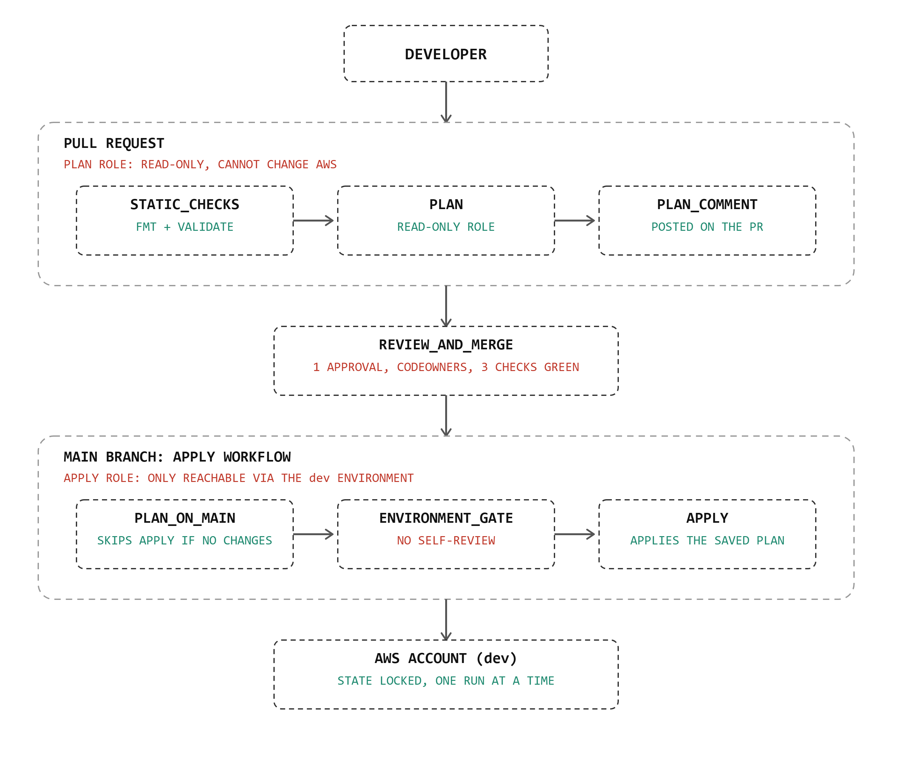
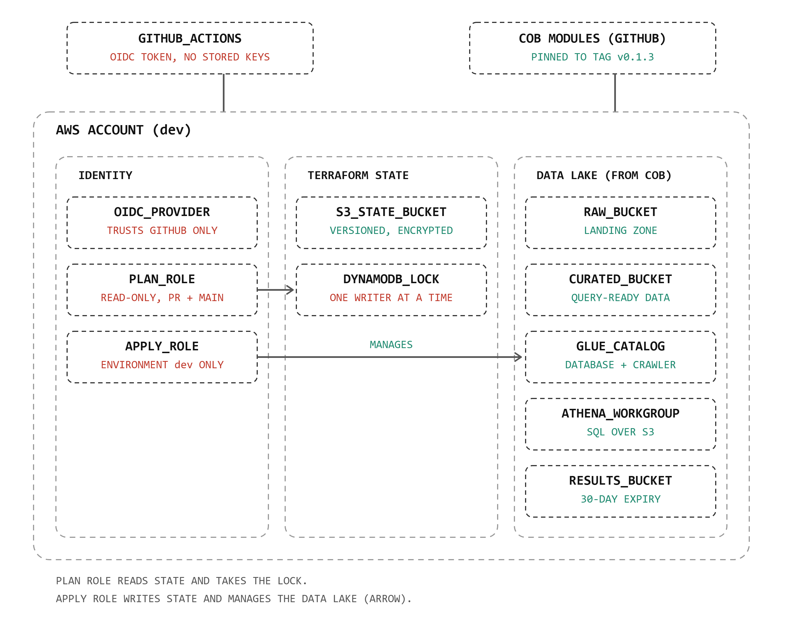

# Architecture

Two diagrams, at two zoom levels. Read them in this order.

## 1. Delivery pipeline

How a change travels from a developer to AWS, and where each human and
machine gate sits.

- **Pull request.** Static checks run first with no AWS credentials. The
  plan job then assumes a read-only role, so nothing in a PR can change
  infrastructure. The plan is posted as a comment.
- **Review and merge.** A ruleset requires an approval from someone other
  than the author, code-owner review, and all three checks green.
- **Main branch.** The apply workflow plans again, because `main` may have
  moved since the PR. If nothing changed, it stops. If something changed,
  it waits at the `dev` environment for two reviewers (not the person who
  merged), then applies the saved plan using the apply role.

## 2. AWS side: identity, state and the data lake

- **Identity.** GitHub presents a short-lived OIDC token. AWS exchanges it
  for temporary credentials only if the token's subject matches a role's
  trust policy. Two roles exist: plan (read-only) and apply (reachable
  only from the `dev` environment).
- **State.** An S3 bucket holds Terraform state, one key per stack. A
  DynamoDB table provides the lock, so two runs cannot write the same state.
- **Data lake.** Provisioned entirely by COB modules pinned to a release
  tag: a raw zone, a curated zone, a Glue catalog with a crawler, and an
  Athena workgroup with its own results bucket. There is no VPC, because
  S3, Glue and Athena are regional services.

## Trust model

A token's subject claim identifies the workflow context. Since mid-2026,
new repositories use the immutable form that embeds numeric IDs.

| Context | Subject | Allowed to assume |
|---|---|---|
| Pull request | `repo:OWNER@OWNER_ID/REPO@REPO_ID:pull_request` | plan role |
| Run on `main` | `repo:OWNER@OWNER_ID/REPO@REPO_ID:ref:refs/heads/main` | plan role |
| Job in environment `dev` | `repo:OWNER@OWNER_ID/REPO@REPO_ID:environment:dev` | apply role |

The environment accepts deployments only from `main`, so GitHub and AWS
enforce the same boundary independently.

## Controls

| Control | Where it is enforced |
|---|---|
| No stored AWS credentials | OIDC federation |
| Read-only planning | Plan role has no write permissions |
| Apply only after human approval | `dev` environment with two reviewers |
| Deployer cannot approve | Environment "prevent self-review" |
| Only reviewed code reaches `main` | Ruleset: PR, approval, code owners, no bypass, no force pushes |
| Broken code cannot merge | Required checks (static checks required directly, not only plan) |
| Exactly the approved plan is applied | Saved plan file; stale plans are refused |
| No conflicting deployments | Concurrency group plus DynamoDB state lock |
| Unchanged environments cause no noise | Apply skipped when the plan has no changes |
| Pipeline cannot change its own roles | Roles live in `bootstrap/`, applied by an admin; named `gha-*` so the apply role's IAM scope (`cob-*`) never matches them |
| Hung runs cannot hold the lock | Job timeouts |
| Action supply chain | Actions pinned to commit SHAs; Dependabot proposes updates |
| Traceability | Role session names include the run ID, visible in CloudTrail |

## Deliberately not done yet

| Item | Why deferred |
|---|---|
| IAM permissions boundary | One consumer so far; planned when more teams call COB |
| Drift detection (scheduled plan) | Not required by the brief; a scheduled plan with notification is the natural next step |
| Cost estimation in PRs | The data lake costs almost nothing at rest |
| tflint / checkov / policy-as-code | Valuable, but additive; none was needed to meet the requirements |
| `prod` environment | Structure supports it (`environments` list, matrix); not needed to demonstrate the pipeline |
| Private plan storage | The artifact is public in a public repo; acceptable because this stack holds no secrets |
| Native S3 state locking | The DynamoDB lock works; migration is a later cleanup |
| GitHub organization | Would restrict who can change rules; moving the repo changes the owner ID embedded in the OIDC trust policy |

## Consuming COB

| Need | COB module | Notes |
|---|---|---|
| Raw and curated zones | `storage-s3` | Encryption, versioning, public-access block and TLS enforced by default |
| Catalog and query layer | `data-platform` | Calls `iam` and `storage-s3` internally |

Gaps found while consuming COB, and the decision on each, are in
[GAPS.md](GAPS.md).